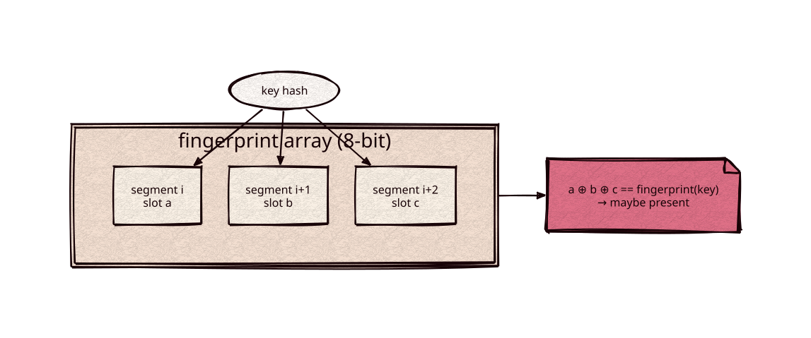

# fusefilter

[](https://github.com/Kronuz/fusefilter/actions/workflows/ci.yml)
[](LICENSE)


Binary fuse filters for C++20 (Graf and Lemire, "Binary Fuse Filters: Fast and Smaller
Than Xor Filters", 2022): an immutable set of 64-bit keys that answers "maybe present"
with no false negatives, a 1/256 false-positive rate, and three memory reads per lookup,
in about 9 bits per key. Header-only, no dependencies.



## ✨ Highlights

- 🔎 **No false negatives**: a stored key always answers present.
- 🎯 **1 in 256 false positives** in about 9 bits per key, close to the 8-bit floor.
- ⚡ **Three memory reads per lookup**: 4 ns at 100,000 keys.
- 💾 **Serializable**: `serialize()` to bytes, and `deserialize()` rejects malformed
  input; a libFuzzer target ran 227 million inputs clean.
- 🗺️ **Readable in place**: `filter8_view::parse()` answers from the serialized bytes
  themselves, so a filter in a mapped file costs no memory of its own.

## 📦 Installation

Requires a C++20 compiler; CMake 3.14 or newer for the CMake route. CI builds it on
Linux (x86_64, arm64), macOS (arm64, x86_64), and FreeBSD, plus ASan, UBSan, and TSan
builds.

```cmake
include(FetchContent)
FetchContent_Declare(fusefilter
  GIT_REPOSITORY https://github.com/Kronuz/fusefilter.git
  GIT_TAG        main)
FetchContent_MakeAvailable(fusefilter)

target_link_libraries(my_app PRIVATE fusefilter::fusefilter)
```

## 🚀 Quick start

```cpp
#include "fusefilter.hh"

#include <cassert>
#include <cstdint>
#include <string>
#include <vector>

int main() {
	std::vector<std::uint64_t> keys = {0x9e3779b97f4a7c15, 0xbf58476d1ce4e5b9, 0x94d049bb133111eb};  // hashes of your keys
	auto f = fusefilter::filter8::build(keys);          // duplicates are ignored
	assert(f.contains(keys[0]));                        // never a false negative
	bool maybe = f.contains(0x1234);                    // false: certainly absent

	const std::string bytes = f.serialize();
	auto g = fusefilter::filter8::deserialize(bytes);   // an owned copy; nullopt when malformed
	auto v = fusefilter::filter8_view::parse(bytes);    // reads `bytes` in place, which must outlive it
	assert(g && g->contains(keys[1]) && v && v->contains(keys[2]));
	(void)maybe;
}
```

## 🧩 How it works

Each key hashes to three slots, one in each of three consecutive segments of a
power-of-two length, and the filter stores 8-bit fingerprints such that the three
slots' XOR equals the key's fingerprint. Construction peels the 3-hypergraph (a slot
that only one key maps to fixes that key's fingerprint last) and retries with a new
seed in the rare case a core remains; hashes are processed in slot order so the counting
pass walks memory nearly sequentially. Sizing follows the paper: 1.125 slots per key for
large sets, more for small ones.

## ⚡ Performance

Random 64-bit keys on an Intel i9-9980HK, Apple clang `-O3 -march=native`
(`bench/bench.cc`):

| Keys | Build | Lookup (present / absent) | Bits per key | False positives |
|---:|---:|---:|---:|---:|
| 100,000 | 115 ns/key | 4.1 / 4.0 ns | 9.50 | 0.40% |
| 1,000,000 | 127 ns/key | 5.6 / 5.6 ns | 9.04 | 0.39% |
| 10,000,000 | 155 ns/key | 14.6 / 14.9 ns | 9.02 | 0.39% |

The host was not idle; lookups past the last-level cache (10M keys, 11 MB) pay a
memory access each.

## 🧪 Correctness

The test checks no false negatives from 0 to 1,000,000 keys, the false-positive rate and
size, duplicates, the serialization round trip, and that every truncation and
inconsistent layout is rejected. `fuzz/fuzz_deserialize.cc` is a libFuzzer target (227M
runs clean under ASan and UBSan).

## 🛠️ Building and testing

```sh
cmake -S . -B build && cmake --build build && ctest --test-dir build
build/fusefilter_bench 10000000
```

## 🎯 When to use it

- ✅ Skipping disk reads for absent keys in an immutable set: SSTables, segment term lookups.
- ❌ Sets that change: rebuild on every change, or use a Bloom or cuckoo filter.

## 📚 Documentation

- [AGENTS.md](AGENTS.md): repository map and invariants.

## 🤝 Contributing

Issues and pull requests are welcome. Read [AGENTS.md](AGENTS.md) first. CI must
pass on every platform.

## 📄 License

MIT, Copyright (c) 2026 Germán Méndez Bravo. See [LICENSE](LICENSE).
