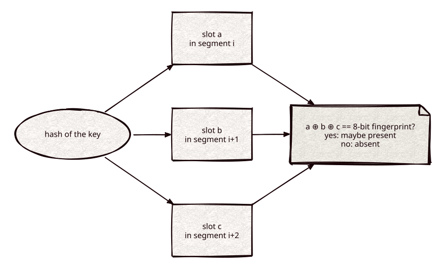

# fusefilter

Part of [Kronuz C++ Libraries](https://github.com/Kronuz/cpp-libraries), a collection of small, reusable C++ libraries.

[](https://github.com/Kronuz/fusefilter/actions/workflows/ci.yml)
[](LICENSE)


Header-only binary fuse filters for C++20: an immutable 64-bit key set in about 9 bits per key, three reads per lookup.
It answers "maybe present" with no false negatives and about one false positive
in 256. Each key's hash picks one 8-bit slot in each of three consecutive
segments, and the slots' XOR is its fingerprint (Graf and Lemire, 2022). Reach
for it to skip disk reads for absent keys in a set that does not change.



## ✨ Highlights

- **No false negatives.** A key the filter was built from always answers
  present.
- **1 in 256 false positives** in 9.0 to 9.5 bits per key, against a floor of 8
  for 8-bit fingerprints.
- **Three memory reads per lookup**, one per segment.
- **Fast, lean builds.** `build` reads the keys without copying or sorting them,
  in about 24 bytes per key of working set; duplicates are ignored, and a set that
  has some is sorted once.
- **Serializable.** `serialize()` writes a versioned byte string, and
  `deserialize()` returns `std::nullopt` for malformed input.
- **Readable in place.** `filter8_view::parse()` answers from the serialized
  bytes, so a filter in a mapped file costs no memory of its own.

## 🚀 Quick start

```cpp
#include "fusefilter.hh"

#include <cstdint>
#include <cstdio>
#include <string>
#include <vector>

int main() {
	std::vector<std::uint64_t> keys;  // 64-bit hashes of your keys
	for (std::uint64_t i = 1; i <= 100000; ++i)
		keys.push_back(i * 0x9e3779b97f4a7c15);
	auto f = fusefilter::filter8::build(keys);  // duplicates are ignored

	std::printf("%d\n", f.contains(keys[42]));  // 1, never a false negative
	std::printf("%d\n", f.contains(12345));  // 0 here; 1 for about 1 in 256 absent keys
	std::printf("%zu bytes\n", f.size_in_bytes());  // 118784 bytes, 9.5 bits per key

	const std::string bytes = f.serialize();
	auto copy = fusefilter::filter8::deserialize(bytes);  // owns its array; nullopt when malformed
	auto view = fusefilter::filter8_view::parse(bytes);  // reads `bytes` in place, which must outlive it
	std::printf("%d %d\n", copy->contains(keys[7]), view->contains(keys[7]));  // 1 1
}
```

## 📦 Installation

Requires a C++20 compiler with `unsigned __int128` (GCC or Clang) and CMake 3.14
or newer; no dependencies. CI builds it on Linux (x86_64, arm64), macOS (arm64,
x86_64), and FreeBSD, plus ASan, UBSan, and TSan builds.

```cmake
include(FetchContent)
FetchContent_Declare(fusefilter
  GIT_REPOSITORY https://github.com/Kronuz/fusefilter.git
  GIT_TAG        a42bd15a136e7a5a21456fff083eedd40f3d02c1)  # or main for the tip
FetchContent_MakeAvailable(fusefilter)

target_link_libraries(my_app PRIVATE fusefilter::fusefilter)
```

```cpp
#include "fusefilter.hh"
```

## 🎯 When to use it

Use it in front of a disk read or a remote lookup for a key set built once:
SSTables, segment term lookups, immutable indexes.

Not for:

- **Sets that change.** Every change is a rebuild;
  [bloom-filter](https://github.com/Kronuz/bloom-filter) takes inserts.
- **Keys that are not 64-bit integers.** Hash strings and records first, for
  example with [hashes](https://github.com/Kronuz/hashes).
- **Rates below 1 in 256.** The fingerprints are 8 bits, and `filter8` is the
  only width.

## ⚡ Performance

`bench/bench.cc` builds each filter from N random 64-bit keys, then looks up all
N present keys and N absent ones. Build is ns per key, from a fresh copy of the
keys; Lookup is ns per call, `present / absent`, for independent queries in a
loop (throughput, not the latency of one call); both are lower is faster. Bits
per key is the filter's size over N, and False positives is the share of the
absent keys reported present. The rows are `fusefilter` (`filter8`);
`xor_singleheader`, the `binary_fuse8_t` of
[FastFilter/xor_singleheader](https://github.com/FastFilter/xor_singleheader) at
commit `5426b7d`: the C implementation by Thomas Mueller Graf and Daniel Lemire,
who designed binary fuse filters ([arXiv:2201.01174](https://arxiv.org/abs/2201.01174)),
so it is the same filter written by its authors; and two Bloom
filters, `boost::bloom::filter<uint64_t, K>` of [Boost
1.92.0](https://www.boost.org/doc/libs/release/libs/bloom/): `Bloom k=6` with
the same bits per key as `fusefilter`, and `Bloom k=8`, sized by Boost for the
0.39% that `fusefilter` reaches. The filters hash differently, so their answers
on absent keys differ; every filter reports every present key present (the bench
aborts on a false negative), and `fusefilter` and `xor_singleheader` both measure 0.39%
false positives.

Apple M4 Pro (macOS 26) and Intel Core i9-9980HK (macOS 15), Apple clang 17,
CMake `Release` (`-O3 -DNDEBUG`), median of 5 runs:

| Keys | Filter | Bits per key | False positives | Build, M4 Pro | Lookup, M4 Pro | Build, i9 | Lookup, i9 |
|---:|---|---:|---:|---:|---:|---:|---:|
| 1,000,000 | fusefilter | 9.04 | 0.39% | 9.7 ns/key | 1.6 / 1.5 ns | 30 ns/key | 5.8 / 5.6 ns |
| 1,000,000 | xor_singleheader | 9.04 | 0.39% | 18.8 ns/key | 1.5 / 1.6 ns | 39 ns/key | 5.7 / 5.6 ns |
| 1,000,000 | Bloom k=6 | 9.04 | 1.28% | 4.9 ns/key | 3.1 / 8.9 ns | 13 ns/key | 10.5 / 14.7 ns |
| 1,000,000 | Bloom k=8 | 11.54 | 0.39% | 6.2 ns/key | 4.2 / 9.6 ns | 15 ns/key | 12.8 / 14.2 ns |
| 10,000,000 | fusefilter | 9.02 | 0.39% | 14.3 ns/key | 2.0 / 2.0 ns | 40 ns/key | 12.8 / 12.8 ns |
| 10,000,000 | xor_singleheader | 9.02 | 0.39% | 24.8 ns/key | 2.0 / 2.0 ns | 53 ns/key | 12.5 / 12.4 ns |
| 10,000,000 | Bloom k=6 | 9.02 | 1.32% | 5.9 ns/key | 4.1 / 9.9 ns | 25 ns/key | 20.6 / 19.3 ns |
| 10,000,000 | Bloom k=8 | 11.54 | 0.39% | 7.0 ns/key | 5.4 / 11.2 ns | 46 ns/key | 37.7 / 23.1 ns |

```sh
cmake -B build -DCMAKE_BUILD_TYPE=Release -DFUSEFILTER_BENCH_COMPARATORS=ON
cmake --build build --target fusefilter_bench
build/fusefilter_bench 1000000 10000000
```

`fusefilter` looks up at the speed of `xor_singleheader` and 2.2 to 2.9 times faster
than `Bloom k=8` on a present key, at 9.0 bits per key against 11.5 for the same
false-positive rate. It builds 1.3 to 1.9 times faster than `xor_singleheader`: it
reads each key twice and sorts none unless it finds a duplicate, groups the hashes into
a few hundred buckets so that counting walks the tables nearly in order, and fetches
the slots the peel will need before it gets to them. The Bloom filters build 1.6 to 2.4
times faster than `fusefilter`, except `Bloom k=8` at 10 million keys on the i9, which is
1.2 times slower. At 10 million keys the 11 MB filter is past the last-level cache of
the i9, and each read is a memory access.
[docs/perf/comparators.md](docs/perf/comparators.md) has the method, the spread
of the runs, and every row.

## 📚 Documentation

- [ARCHITECTURE.md](ARCHITECTURE.md): lookup, construction, and the serialized
  form.
- [docs/perf/comparators.md](docs/perf/comparators.md): the benchmark's method and
  every row for both machines.
- [CHANGELOG.md](CHANGELOG.md): what changed.
- [AGENTS.md](AGENTS.md): repository map and invariants.
- [Catalog entry](https://github.com/Kronuz/cpp-libraries/blob/main/AGENTS.md#fusefilter)
  in Kronuz C++ Libraries.

## 🛠️ Building and testing

```sh
cmake -B build
cmake --build build
ctest --test-dir build
```

The test checks for false negatives from 0 to 1,000,000 keys, the false-positive
rate and size, duplicates, the serialization round trip, and that every
truncation and inconsistent layout is rejected. A second test builds sets of every
shape (0 to 1,000,000 keys, up to half of them duplicates, all keys equal, keys
chosen to fail a seed) against `test/fusefilter_old.hh`, a frozen build that sorts
its keys first: the same seed and shape, no false negative, bytes that depend on
the set alone, and a working set within bounds. `tools/mutants.py` breaks the build
in 16 ways and requires that test to fail on each. `-DFUSEFILTER_FUZZ=ON` with
clang builds the libFuzzer targets `fusefilter_fuzz` and `fusefilter_fuzz_build`.

## 🤝 Contributing

Issues and pull requests are welcome. Read [AGENTS.md](AGENTS.md) and the
catalog's [rules of engagement](https://github.com/Kronuz/cpp-libraries/blob/main/AGENTS.md#rules-of-engagement)
first; CI must pass on every platform.

## 📄 License

MIT, Copyright (c) 2026 Germán Méndez Bravo. See [LICENSE](LICENSE).
